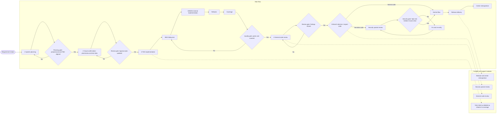

# Delivery Workflow

This document defines the software delivery flow used for this repository.

## Flow

## Stage Definitions

| Stage | Goal | Outputs | Entry / exit conditions |
|---|---|---|---|
| 1 System planning | Define scope, interfaces, transaction data, and acceptance criteria | `claude/plain/<id>-plan.md`, PRD, test-case list, interface and transaction review, TBD register | Entry: requirement accepted and pro/personal scenario identified. Exit: SOP/flow aligned, PRD and test cases complete, TBDs have owner/date/decision |
| 2 Visual confirmation | Review milestones and freeze test data and control instructions | `plan/review/<id>-review.md`, updated `plan/review/<id>-approve-plan.md`, retrospective notes | Entry: planning artifacts are versioned. Exit: milestone reviewed, data and control instructions verified, Approve plan updated |
| 3 TDD implementation | Drive implementation with failing tests, then refactor and measure coverage | RED/GREEN evidence, refactor notes, coverage report, test report | Entry: test-case list reviewed. Exit: RED reproducible, GREEN passing, refactor behavior-neutral, coverage threshold met |
| 4 General code review | Clean quality, refactor, and find latent defects | Code-review record, issue list, static checks, build result | Entry: TDD quality gate passed. Exit: blocking findings closed |
| 5 Branch decision | Classify normal versus sensitive code | Classification record and branch label | Entry: code review passed. Exit: normal code flows on; sensitive code must enter security review |
| 6 Security special review | Verify sensitive code for security issues | Security report, fix record, re-verification result | Entry: classified as sensitive. Exit: high/medium issues cleared and signed off |
| 7 Release and retrospective | Deliver and capture improvement actions | Release record, delivery manifest, rollback plan, retrospective, action register | Entry: all gates passed. Exit: release traceable, rollback usable, actions assigned |

## Pro And Personal Scenarios

- `pro`: PRD baseline, two-person review, isolated test data, coverage threshold,
  non-author code review, security review and dual sign-off, archived release.
- `personal`: review and evidence may be combined, but the plan document, RED
  evidence, code-review checklist, sensitive-code security review, and release
  record cannot be omitted.
- Sensitive-code handling cannot be downgraded in either scenario.

## Sensitive Code Scope

Authentication and authorization, payment and transactions, keys and
encryption, personal data, upload and deserialization, command execution,
dependencies and supply chain, deployment and infrastructure, model weights and
checkpoint loading, and external interfaces or data export.

## Key Risks

- TBDs left open cause rework. Keep owner, due date, impact, decision, and
  closure evidence.
- Pro/personal boundaries drift. Keep the approval matrix explicit.
- Visual confirmation becomes a rubber stamp. Require runnable data, expected
  results, control instructions, and rollback triggers.
- Approve plan drifts from the real design. Store versions and diffs.
- Fake TDD appears through post-hoc tests or weak assertions. Require
  reproducible RED evidence and behavior-level assertions.
- Refactoring causes regressions. Keep behavior changes separate and rerun the
  same test set before and after.
- Review happens too late. Keep changes small and triage findings by severity.
- Sensitive code is misclassified. Keep a sensitive-path list and default to
  sensitive when uncertain.
- Security fixes are not re-verified. Require clear high/medium issues and
  retained verification evidence.
- Release rollback is untested. Verify smoke tests, monitoring, and rollback
  before release.
- Retrospective actions are not closed. Track them as the next planning input.
